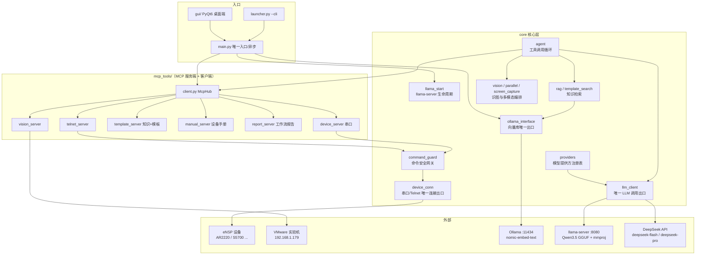
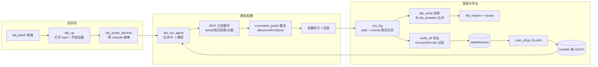

# NetworkClaw 架构

一句话：**本地大模型 + RAG + MCP 工具，面向网络设备（华为 eNSP 实验环境）的
配置代理与批量陪跑系统**。端到端链路：本地/云端 LLM 通过 MCP 工具 Telnet/串口
登录设备下发命令，命令过安全网关，全程留痕，实验结果导出为微调数据。

## 1. 总体结构



分层铁律（改动前先看 `docs/` 与 MEMORY 约定）：

- `llm_client` 是**唯一** LLM 调用出口，业务模块不得自行拼 HTTP；
- 端点/密钥/能力画像只在 `providers.py` 定义，`config/llm.json` 与 `.env` 只做覆盖；
- 所有设备通道（Telnet/串口）必须过 `command_guard`，密码不落盘；
- 向量库集合只在 `ollama_interface.py` 注册，句柄现取现用。

## 2. 批量实验数据流（毕设主线的"跑实验→产数据"闭环）



要点：

- **验收基准**来自实验包自带参考答案（`data/lab_answers/`），
  「设备开机自带答案」的假阳性用 `net`（净提升）指标剔除；
- 调度器只给后台任务 2 分钟超时，长任务必须经 `tools/spawn.py` 脱离进程启动；
- 实验中每条命令的裁决与执行都写 `logs/command_audit.log`（密码不落盘）。

## 3. 关键外部依赖

| 依赖 | 版本/端口 | 说明 |
|---|---|---|
| llama-server | :8080 | 必须 `--jinja` 才返回 tool_calls；视觉要加载 mmproj |
| Ollama | :11434 | Embedding 用 `nomic-embed-text`；挂了不许清索引（先 `check_embedder`） |
| VirtualBox | 5.1.24 | eNSP 路由器 = VBox VM 克隆；路径写死在 eNSP `cfg/config_sys.ini` |
| eNSP | 1.2.00.510 | 58 个实验包，`.topo` 为 GBK 双 XML 拼接（解析见 `tools/topo_extract.py`） |
| DeepSeek | api.deepseek.com | `deepseek-flash`(多模态) / `deepseek-pro`(深度推理)；旧名走 ALIASES |

## 4. 目录速览

```
main.py           唯一入口
core/             23 个核心模块（见第 1 节）
mcp_tools/        7 个 MCP 服务端 + McpHub 客户端（26 个工具，清单见 docs/mcp_tools.md）
tools/            62 个运维/实验脚本（vm_*、lab_*、build_sft、topo_extract…）
training/         LoRA/QLoRA 微调（train_sft.py，见 training/README.md）
gui/              PyQt6 桌面端
knowledge/        命令模板 CSV、实验文档、拓扑数据集 topology/
data/             运行数据（finetune/、lab_answers/、topology_images/…）
session/          会话级设备技能：session/<会话>/skill/<设备名>/SKILL.md + history.jsonl
docs/             本文档 + packaging + sft_dataset + troubleshooting
tests/            pytest（离线可跑）
```
